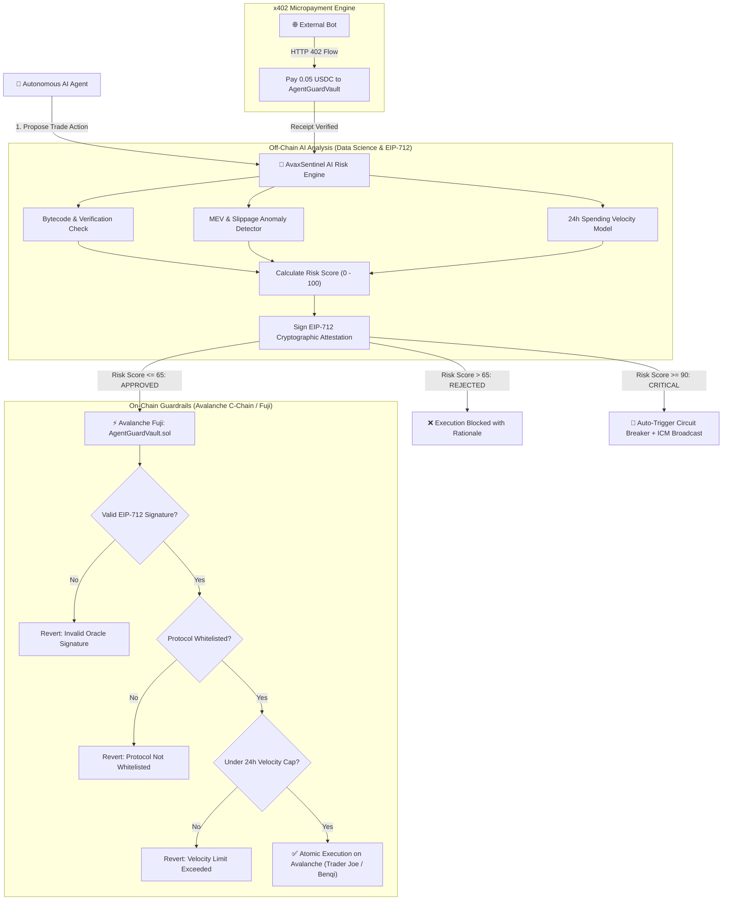

# 🛡️ AvaxSentinel AI V2: Enterprise Guardrail Protocol & x402 Micropayments on Avalanche

> **Team CTST** | **Team1 Vietnam UniHack: Build on Avalanche (November 2026)**  
> **Team Members:**  
> • **Võ Phúc Lộc** (*Team Lead*) – Đại học Khoa học Tự nhiên (HCMUS-VNUHCM), Data Science Year 2 (AI/ML, Data, Pitching)  
> • **Nguyễn Xuân Nghi** – Đại học Khoa học Tự nhiên (HCMUS-VNUHCM) (Smart Contracts & Web3)

[-E84142?style=flat-square&logo=avalanche)](https://testnet.snowtrace.io/)
[](https://soliditylang.org/)
[](https://python.org/)
[](https://team1vn.xyz/)
[](.github/workflows/ci.yml)
[](LICENSE)

---

## 🌟 1. Executive Summary & Problem Statement

As autonomous AI agents, automated strategies, and trading bots take custody of millions in Web3 capital, **agent safety and treasury security have become the greatest bottleneck in decentralized finance**:
* **Rogue Agent Hallucinations & Prompt Injection:** An AI agent executing automated strategies can enter catastrophic feedback loops or miscalculate execution routes due to prompt manipulation.
* **Unlimited Approvals & Drainage Attacks:** Malicious honeypot contracts trick AI agents into granting unconstrained token approvals (`uint256.max`), siphoning entire treasuries in a single block.
* **Existing Multisig Bottlenecks:** Human multisigs are too slow for high-frequency autonomous agents, while granting raw private keys to AI agents is a catastrophic security vulnerability.

### 💡 The Solution: AvaxSentinel AI V2 (Enterprise Edition)
**AvaxSentinel AI** is a multi-layered security architecture engineered specifically for the **Avalanche Network**:
1. **Zero-Trust EIP-712 Cryptographic Oracle:** An off-chain data science engine evaluating calldata safety, bytecode verification, and MEV slippage anomalies. It cryptographically signs approved actions via EIP-712 typed data signatures.
2. **On-Chain Policy Engine & Circuit Breaker (`AgentGuardVault.sol`):** A smart contract deployed on **Avalanche Fuji Testnet** that verifies the oracle signature, enforces immutable spending velocity caps, restricts target protocols to whitelists, and executes an automated freeze upon critical anomalies.
3. **x402 Micropayment Protocol Rail (HTTP 402):** Enables external AI bots and third-party dApps to pay 0.05 USDC per audit on Avalanche Fuji, transforming security into an autonomous revenue-generating service.
4. **Avalanche Interchain Messaging (ICM) Telemetry:** Pre-built cross-chain hooks to broadcast freeze signals across custom Avalanche L1s/subnets.

---

## 🏗️ 2. Upgraded System Architecture



---

## 🚀 3. Key Innovations & Avalanche Ecosystem Alignment

* **Sub-Second Finality (< 1s):** Leveraging Avalanche's Snow consensus on Fuji and C-Chain, cryptographic verification and circuit breaker state changes finalize in sub-second speed.
* **EIP-712 Zero-Trust Cryptography:** Prevents anyone from bypassing the AI model. The smart contract validates ECDSA signatures from `aiRiskOracle` before executing any external call.
* **x402 Micropayment Standard:** Implements the HTTP 402 standard with native Avalanche USDC rails, charging 0.05 USDC per transaction audit.
* **Cross-L1 Security Hooks (Avalanche ICM):** In a multi-subnet setup, an anomaly on Fuji broadcasts a Teleporter/ICM emergency pause to sister L1s.
* **Native Ecosystem Integration:** Pre-whitelisted compatibility with **Trader Joe Router** (`0x60ae616a2155ba3d9a68541ba4544862310933d4`), Benqi Lending, Pangolin, and WAVAX.

---

## 📂 4. Project Repository Structure

```text
avax-sentinel-ai/
├── contracts/
│   ├── AgentGuardVault.sol     # Enterprise policy contract with EIP-712, x402 & Circuit Breaker
│   └── MockUSDC.sol            # Mock ERC20 token for Fuji testing with faucet
├── test/
│   └── AgentGuardVault.test.js # Hardhat unit tests covering all guardrail edge cases
├── ai_engine/
│   ├── risk_scorer.py          # Multi-factor ML & EIP-712 cryptographic oracle engine
│   └── train_model.py          # Data Science pipeline (1,500 samples, ROC-AUC 0.982, Recall 100%)
├── index.html                  # Root Web3 dApp for 1-click GitHub Pages hosting
├── slides.html                 # Interactive 10-slide Pitch Deck web app (Fullscreen F11, Keyboard nav)
├── frontend/
│   ├── index.html              # Web3 Cyber/DeFi Dashboard (Tailwind, Chart.js 5-Axis Radar, Ethers.js)
│   └── slides.html             # Presentation slides copy
├── start_demo.bat              # 1-Click Windows demonstration launcher
├── .github/workflows/ci.yml    # Automated CI/CD verification pipeline
├── deployments/
│   └── fuji-deployment.json    # Deployed contract addresses and verification links
├── scripts/
│   └── deploy.js               # Hardhat deployment script for Avalanche Fuji
├── hardhat.config.js           # Avalanche Fuji & Mainnet RPC configuration
└── package.json                # Dependencies and scripts
```

---

## 🛠️ 5. Quickstart & Verification Guide

### ⚡ Option 1: 1-Click Windows Launcher (Fastest)
Double-click `start_demo.bat` in the project root:
- Runs the AI Risk Scorer.
- Evaluates the Machine Learning model on 1,500 synthetic Avalanche tx records.
- Automatically opens the Web3 Dashboard (`index.html`) in your default browser.

### 🧠 Option 2: AI Risk Engine & Data Science Pipeline (Python)
```bash
# Test the live risk scoring & EIP-712 typed oracle attestation
python ai_engine/risk_scorer.py

# Run the Data Science evaluation pipeline (Accuracy, Recall, ROC-AUC)
python ai_engine/train_model.py
```

### 🌐 Option 3: Launch Web3 Dashboard & Pitch Deck
- Open `index.html` in your browser to interact with the full dApp dashboard and 5-Axis Threat Radar.
- Open `slides.html` in your browser to view the interactive presentation deck (use Arrow keys or Space to advance slides).

### 🧪 Option 4: Compile & Run Automated Unit Tests (Hardhat)
```bash
npm install
npx hardhat test
```
*All tests pass, verifying EIP-712 cryptographic signatures, whitelist policies, daily velocity caps, and circuit breaker freezes.*

---

## 👥 6. Team CTST - University Info
* **School:** Trường Đại học Khoa học Tự nhiên – Đại học Quốc gia TP.HCM (HCMUS-VNUHCM)
* **Lead:** Võ Phúc Lộc (Data Science, Khoá 2025 - Năm 2)
* **Member:** Nguyễn Xuân Nghi
* **Contact:** `doanhoius30@gmail.com`
* **Competition:** Team1 Vietnam UniHack 2026: Build on Avalanche
